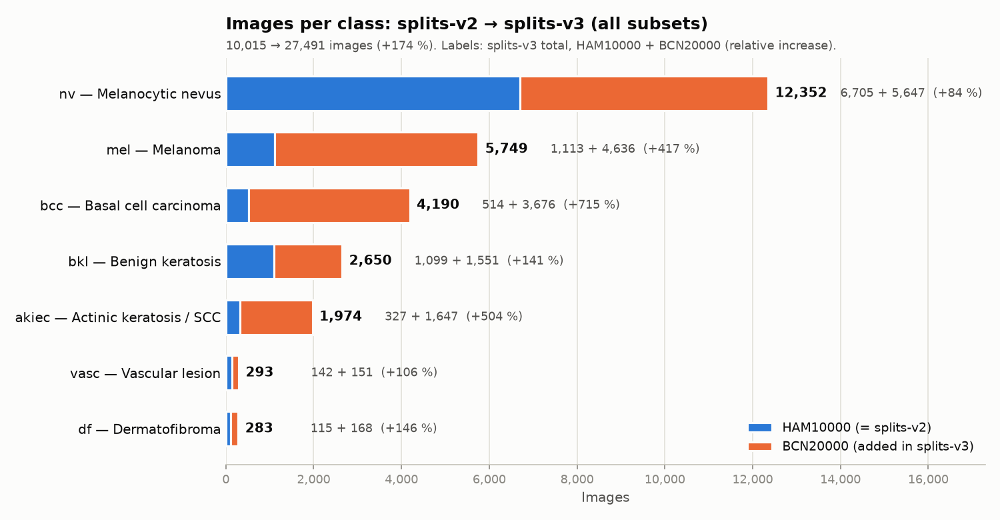
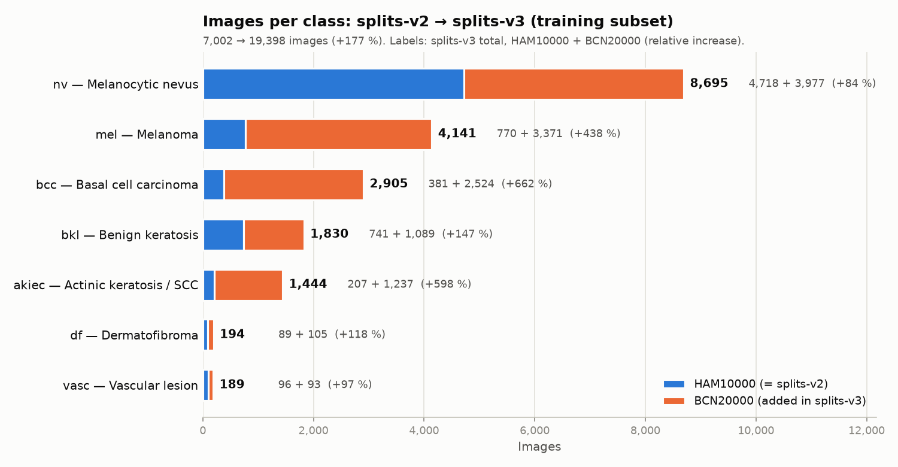

# Decision Log

Record of design decisions, their rationale, and their observed consequences.
Each entry is dated and references the run(s) that support it.

---

## D-001 — Train EfficientNet-B4 at HAM10000 native resolution (600 x 450)

- **Date:** 2026-11-11
- **Status:** Tested in run B1 — result **not satisfactory**; superseded for the B4 baseline by D-002 (run B2)
- **Related commits:** `afa50d4` (Use of native resolution), `65a8432` (Data balance with native resolution), `6a608b5` (New training binary)
- **Related run:** `runs/binary/B1_binary_B4_600x450_20261111_112623` (see `protocol.md`, run B1)

### Context

The V1 pipeline resized all images to 224 x 224, which discards fine-grained
dermoscopic detail and distorts the 4:3 aspect ratio. The goal of V2 was to
keep the original HAM10000 images untouched (600 x 450 px, W x H, copied byte
for byte, no JPEG re-encoding) and feed them to the network at that size.

### Decision

Feed images to EfficientNet-B4 at **600 x 450 (input tensor 450 x 600 x 3)**
instead of resizing to a fixed square input.

### Important caveat: this exceeds EfficientNet-B4's design resolution

EfficientNet-B4 was designed and pretrained (via compound scaling) for an input
of **380 x 380 px**. The native HAM10000 input used here is well above that:

| | Input (H x W) | Pixels | Final feature map (stride 32) |
|---|---|---|---|
| EfficientNet-B4 design resolution | 380 x 380 | 144,400 | 12 x 12 = 144 positions |
| This run (native HAM10000) | 450 x 600 | 270,000 | 15 x 19 = 285 positions |
| Ratio | | **~1.87x** | **~2x** |

Implications:

- The network's depth and width were scaled for 380 px; at ~1.87x the pixels,
  the receptive fields cover a relatively smaller fraction of the lesion than
  during ImageNet pretraining (a train/test resolution discrepancy with respect
  to the pretrained weights).
- The larger input adds more fine-grained, high-frequency detail (texture, hair,
  JPEG artifacts, ruler marks) that the model can memorize. With only 770
  melanoma training images, this makes overfitting more likely.
- `GlobalMaxPooling2D` over a ~2x larger feature map picks the single strongest
  activation out of 285 positions, which may amplify spurious local cues.
- Cost: ~3 min per epoch with batch size 16 and float32 (~59 min total run).

### Outcome (run B1)

- Validation AUC **0.7985**, AP 0.3251. At threshold 0.50: sensitivity 0.611
  (99/162 melanomas), specificity 0.803, precision 0.273, F1 0.377.
- **Probable overfitting:** train AUC climbed to 0.927 while validation AUC
  plateaued at ~0.80 (gap ~0.12 in the last epoch). Validation loss reached its
  minimum at epoch 6 (0.3130) and never improved after that. It oscillated
  between 0.31 and 0.52 while training loss kept falling.
- Fine-tuning (last 30 backbone layers, lr 1e-5) did not reduce the best
  validation loss: phase 2's best was 0.4111, above phase 1's 0.3130. It only
  raised validation AUC slightly (0.791 -> 0.798). The saved model comes from
  phase 2.

### Interpretation

Exceeding B4's 380 px design resolution is the **leading hypothesis** for the
overfitting. It is not yet proven, because other factors in this run may also
contribute:

1. The training split was **not balanced** (`data/splits-v2`, 11 % melanoma;
   only sqrt class weights were applied).
2. Early stopping and the decision threshold were selected on the **same
   validation set** used for reporting, so the metrics are optimistic.
3. Only light online augmentation was used (flip, rotation 0.2, zoom 0.1).

### Next steps

- Run a **controlled comparison** that changes only the input size: B4 at its
  design resolution (380 x 380, or a 4:3 equivalent such as 384 x 288), all
  other settings identical to B1.
- Optionally test a larger variant whose design resolution is closer to
  600 x 450 (B5: 456, B6: 528, B7: 600) as an alternative to downscaling.
- Repeat on `data/splits-v2-balanced` and report on the held-out test split.

---

## D-002 — Train EfficientNet-B4 at its design resolution (380 x 380)

- **Date:** 2026-11-11
- **Status:** Provisionally adopted as the B4 baseline; native resolution with
  a larger backbone (B5–B7) still to be evaluated
- **Related run:** `runs/binary/B2_binary_B4_380x380_20261111_144536` (see `protocol.md`, run B2)

### Context

Run B1 (D-001) trained B4 at the native 600 x 450, about 1.87x the pixels of
B4's 380 x 380 design resolution, and showed probable overfitting. B2 is the
controlled comparison proposed in D-001.

### Decision

Train B4 at **380 x 380 (input tensor 380 x 380 x 3)**. Every other setting is
identical to B1: same script (`scripts/train_binary_mel_native.py`), same data
(`data/splits-v2`), seed, hyperparameters, augmentation, and callbacks. The
only change is `--img-size 380 380`.

Condition to note: the 600 x 450 (4:3) images are resized on the fly to a
square 380 x 380 with area interpolation. This **does not preserve the aspect
ratio**, so lesions are slightly squashed horizontally (all 8,505 images were
resized).

### Outcome (B2 vs B1)

| Metric (validation) | B1 — 600 x 450 | B2 — 380 x 380 | Change |
|---|---|---|---|
| ROC AUC | 0.7985 | **0.8175** | +0.019 |
| Average Precision | 0.3251 | **0.3434** | +0.018 |
| Best val_loss (phase 1 / phase 2) | 0.3130 / 0.4111 | **0.3071 / 0.3788** | lower |
| Train AUC − val AUC (last epoch) | 0.927 − 0.805 = **0.12** | 0.896 − 0.830 = **0.07** | gap ~halved |
| Sensitivity / specificity at chosen threshold | 0.611 / 0.803 (thr 0.50) | 0.599 / 0.813 (thr 0.46) | similar |
| Sensitivity / specificity at thr 0.25 | 0.846 / 0.594 | 0.889 / 0.575 | better sensitivity |
| Total training time | 59:06 | **25:52** | ~2.3x faster |

- The script's automatic "possible overfitting" warning fired in B1 but
  **not in B2**.
- Validation curves were more stable (val_accuracy 0.77–0.88 after epoch 2,
  vs 0.71–0.87 in B1).
- As in B1, fine-tuning did not improve phase 1's best val_loss
  (0.3788 vs 0.3071), although validation AUC kept rising in phase 2
  (0.808 -> 0.830).

### Interpretation

B2 supports the hypothesis from D-001. Training B4 above its design resolution
contributed to the overfitting, and returning to 380 px reduced the generalization
gap while slightly improving ranking quality, at less than half the compute.

Caveats:

- The AUC improvement (+0.019) comes from a single seed and only 162
  validation melanomas. It is probably within run-to-run variance, so it is
  not yet a significant difference.
- The non-overfitting part of the problem remains: the imbalanced training split,
  threshold and early stopping selected on the reported validation set, and
  fine-tuning that does not lower val_loss.
- Square resizing distorts the aspect ratio. A 4:3 input near B4's pixel budget
  (e.g. 440 x 330 or 384 x 288) has not been tested.

### Next steps

- Repeat B1 and B2 with 2–3 seeds to check that the gap and AUC difference hold.
- Test B5–B7 at a resolution closer to native (planned in `protocol.md`;
  run ID not yet assigned, since B3 was used for the splits-v3 run, D-003).
- Move to `data/splits-v2-balanced`, use a separate split for threshold
  selection, and report on the held-out test split.

---

## D-003 — Extend the training data with BCN20000 (splits-v3)

- **Date:** 2026-11-13
- **Status:** Dataset built and verified; run B3 **in progress** (results
  pending, see `protocol.md`, run B3)
- **Related files:** `scripts/balance_dataset_extended.py` (builds the split),
  `scripts/plot_dataset_growth.py` (figures below), `data/splits-v3/`
  (git-ignored)
- **Related run:** `runs/binary/B3_binary_B4_380x380_v3_20261113_115220`

### Context

B1 and B2 point to limited data as a core problem: only 770 training
melanomas, weak separation, and a persistent train/validation gap. BCN20000
(Hospital Clínic de Barcelona, ISIC Archive collection 249, 18,946 dermoscopic
images of 5,440 lesions, 1024 x 1024 px) is the largest public dermoscopic
dataset with lesion-level IDs and uses diagnosis categories that map onto the
HAM10000 classes.

### Decision

Build `data/splits-v3` = HAM10000 + BCN20000, and train B4 at 380 x 380 on it
with every other setting identical to B2.

1. **HAM10000 keeps its official split** (`data/splits-v1`, the same one used
   by splits-v2). HAM validation and test images are unchanged, so B3 can
   still be compared with B2 on exactly the same 1,503 HAM validation images.
2. **BCN20000 is split by `lesion_id`** with the same technique as the original
   HAM split: `GroupShuffleSplit`, 70 / 15 / 15, seed 42 (first split) and 43
   (second split). All images of a lesion stay in one subset.
3. The merged split is checked for leakage: no `lesion_id` or `image_id` is
   shared between training, validation and test. HAM and BCN share no image or
   lesion IDs (`HAM_*` vs `IL_*`).
4. Images are **copied byte for byte** (no resizing, no re-encoding):
   HAM10000 stays 600 x 450 and BCN20000 stays 1024 x 1024. The training
   script resizes both to 380 x 380 on the fly. BCN images are square, so,
   unlike HAM, they are not distorted by the square resize.
5. No offline augmentation (as in splits-v2); imbalance is still handled with
   sqrt class weights.

### Class mapping (BCN20000 `diagnosis_3` -> HAM10000 `dx`)

| BCN20000 diagnosis | Images | HAM10000 class |
|---|---:|---|
| Nevus | 5,647 | `nv` |
| Melanoma, NOS | 4,003 | `mel` |
| Melanoma metastasis | 633 | `mel` (see caveat) |
| Basal cell carcinoma | 3,676 | `bcc` |
| Seborrheic keratosis | 1,268 | `bkl` |
| Solar lentigo | 283 | `bkl` |
| Solar or actinic keratosis | 1,088 | `akiec` |
| Squamous cell carcinoma, NOS | 559 | `akiec` |
| Dermatofibroma | 168 | `df` |
| Vascular (only `diagnosis_2` given) | 151 | `vasc` |
| Scar | 314 | **excluded** (no HAM10000 equivalent) |
| No diagnosis (original BCN test set) | 1,156 | **excluded** |

17,476 BCN images (4,981 lesions) are kept; 1,470 are excluded and listed in
`data/splits-v3/excluded_metadata.csv`. The original BCN diagnosis is kept in
the `source_dx` column of each split's metadata, so any mapping can be
reverted without rebuilding the split.

Mapping rationale and caveats:

- **Melanoma metastasis -> `mel`.** It is melanoma tissue, and a melanoma
  detector that calls it "non-melanoma" would produce a clinically serious
  false negative. Metastases look different from primary melanomas (often
  nodular, amelanotic), so they may be harder to learn and may shift what the
  model treats as "melanoma". `--metastasis exclude` drops them instead.
- **SCC -> `akiec`.** HAM10000's `akiec` already includes intraepithelial
  carcinoma (SCC in situ / Bowen's disease). This only matters for future
  multi-class work; in the binary task both are non-melanoma.
- **Scar** is benign but has no HAM10000 class, so it is excluded to keep the
  seven-class structure.

### Resulting dataset

| Subset | splits-v2 images | splits-v3 images | splits-v2 MEL | splits-v3 MEL | MEL % (v2 -> v3) |
|---|---:|---:|---:|---:|---|
| Training | 7,002 | 19,398 | 770 | 4,141 | 11.0 % -> 21.3 % |
| Validation | 1,503 | 4,036 | 162 | 795 | 10.8 % -> 19.7 % |
| Test | 1,510 | 4,057 | 181 | 813 | 12.0 % -> 20.0 % |
| **Total** | **10,015** | **27,491** | **1,113** | **5,749** | 11.1 % -> 20.9 % |

Training melanomas grow **5.4x** (770 -> 4,141). Every class grows. The
smallest relative gain is `nv` (+84 %); the largest are `bcc` (+715 %),
`akiec` (+504 %) and `mel` (+417 %).

### Consequences to keep in mind

- **Validation metrics are not directly comparable with B1/B2.** The splits-v3
  validation set is 2.7x larger, comes from two hospitals and has about
  twice the melanoma prevalence. AP and precision depend on prevalence (the
  chance level of AP rises from ~0.11 to ~0.20). For a fair comparison, B3
  is also evaluated on the HAM-only part of its validation set, which is
  identical to B2's validation set.
- **Domain shift.** BCN images differ in resolution (1024 x 1024 vs 600 x 450),
  acquisition and patient population, and BCN contains harder cases
  (metastases, amelanotic and acral lesions). Ranking metrics on the mixed set
  can therefore drop even if the model improves on HAM.
- **Cost.** About 2.8x more training images; epochs take ~257 s vs ~100 s
  in B2.

### Outcome (run B3)

*Pending — the run is still in progress. This section will be completed with
the B3 vs B2 comparison (overall, HAM-only and BCN-only validation).*
