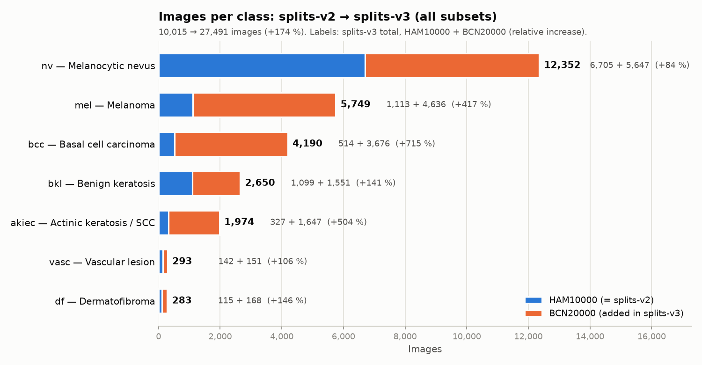
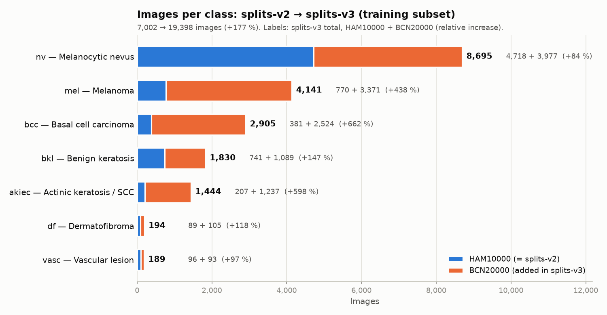

# Experimental Protocol and Run Log

Log of training runs: conditions, results, and observations. Raw outputs live in
`runs/` (git-ignored, copied from the training machine).

---

## Run B1 — Binary MEL vs non-MEL, EfficientNet-B4, native resolution 600 x 450

- **Run ID:** `B1_binary_B4_600x450`
- **Output folder:** `runs/binary/B1_binary_B4_600x450_20261111_112623/`
- **Date:** 2026-11-11, 11:26:23 – 12:25:28 (duration 00:59:06)
- **Script:** `scripts/train_binary_mel_native.py` (commit `6a608b5`), default arguments
- **Status:** Completed
- **Related decision:** D-001 in `decisions.md`

> **Key condition:** this run was trained at the **native HAM10000 resolution
> (600 x 450 px, input tensor 450 x 600 x 3)**. That is ~1.87x the pixels of
> EfficientNet-B4's design resolution (380 x 380). Overfitting was probably
> observed (see Observations), and exceeding B4's working resolution is the
> leading suspected cause.

### Environment

| Item | Value |
|---|---|
| Machine | kikai-one, Linux 7.0.0-42-generic, 1 GPU |
| Python / TensorFlow / Keras | 3.14.8 / 2.22.0-rc0 / 3.16.0.dev2026100804 |
| NumPy / pandas / scikit-learn / Pillow | 2.5.3 / 3.0.6 / 1.9.1 / 12.3.0 |

### Data

- Dataset: `data/splits-v2` (lesion-level split, original files copied byte for
  byte, **not balanced**). The balanced variant was not used.
- All 8,505 images are 600 x 450; 0 resized on the fly; 0 unreadable.
- Binary task: `mel` = positive; `akiec, bcc, bkl, df, nv, vasc` = negative.

| Split | Total | MEL | non-MEL | MEL % |
|---|---|---|---|---|
| Training | 7,002 | 770 | 6,232 | 11.0 % |
| Validation | 1,503 | 162 | 1,341 | 10.8 % |

- Class weights (sqrt): non-mel 0.75, mel 2.132.
- Test split: **not used** in this run.

### Model

- EfficientNet-B4 (ImageNet weights) -> GlobalMaxPooling2D -> Dense(256) ->
  BatchNorm -> Dropout(0.5) -> Dense(1, sigmoid).
- 18,134,112 total parameters; 459,777 trainable in phase 1; 5,269,621 in phase 2.
- Online augmentation: RandomFlip (horizontal and vertical), RandomRotation(0.2), RandomZoom(0.1).
- float32 (no mixed precision), batch size 16, seed 42.

### Training schedule

| Phase | Trainable | Initial LR | Max epochs | Epochs run | Best epoch | Best val_loss | Time |
|---|---|---|---|---|---|---|---|
| 1 – head | Head only (backbone frozen) | 5e-4 | 15 | 11 | 6 | 0.3130 | 33.9 min |
| 2 – fine-tuning | Last 30 backbone layers (BatchNorm frozen) | 1e-5 | 15 | 7 | 2 | 0.4111 | 24.0 min |

- Callbacks: EarlyStopping(val_loss, patience 5, restore best weights);
  ReduceLROnPlateau(val_loss, factor 0.3, patience 2).
- Threshold mode: `f1` (selected on the validation set) -> 0.50.

### Results (validation, final model)

| Metric | Value |
|---|---|
| ROC AUC | **0.7985** |
| Average Precision | 0.3251 |
| Threshold | 0.50 |
| Sensitivity (MEL recall) | 0.6111 (99 / 162) |
| Specificity | 0.8031 |
| Precision (MEL) | 0.2727 |
| F1 (MEL) | 0.3771 |
| Balanced accuracy | 0.7071 |
| Accuracy | 0.7824 |

Confusion matrix:

| | Pred non-MEL | Pred MEL |
|---|---|---|
| **Actual non-MEL** | 1,077 (TN) | 264 (FP) |
| **Actual MEL** | 63 (FN) | 99 (TP) |

Selected points from the threshold sweep:

| Threshold | Sensitivity | Specificity | Precision | FN | FP |
|---|---|---|---|---|---|
| 0.10 | 0.951 | 0.439 | 0.170 | 8 | 752 |
| 0.20 | 0.889 | 0.541 | 0.190 | 18 | 615 |
| 0.25 | 0.846 | 0.594 | 0.201 | 25 | 545 |
| 0.30 | 0.796 | 0.641 | 0.211 | 33 | 482 |
| 0.50 | 0.611 | 0.803 | 0.273 | 63 | 264 |

Reaching the 0.85 sensitivity target needs a threshold of about 0.25. At that
threshold the model raises ~545 false alarms out of 1,341 negatives.

### Observations

1. **Probable overfitting.** Train AUC rose steadily to 0.927 while validation
   AUC plateaued around 0.79–0.81 (gap ~0.12 at the last epoch). Train loss fell
   from 0.95 to 0.27. Validation loss reached its minimum at epoch 6 (0.3130),
   then oscillated between 0.31 and 0.52 and never improved again.
2. **Resolution above B4's design input.** At 600 x 450 the input has ~1.87x
   the pixels of B4's 380 x 380 design resolution, and the final feature map is
   15 x 19 instead of 12 x 12. This is the leading suspected cause of the
   overfitting (more high-frequency detail to memorize, and a mismatch with the
   pretrained receptive-field scale), but this run alone does not isolate it.
3. **Fine-tuning did not help.** Phase 2 did not improve on phase 1's best
   val_loss (0.4111 vs 0.3130). Validation AUC rose only marginally
   (0.791 -> 0.798) while train AUC kept climbing.
4. **Unstable validation accuracy** (0.71–0.87 across epochs). This suggests
   predictions near the decision boundary are sensitive to small weight changes.
5. **Weak separation.** Median P(mel) is 0.56 for actual melanomas and 0.16 for
   non-melanomas. The upper 10 % of non-melanomas reach P(mel) >= 0.65.

### Limitations

- Early stopping and threshold selection used the **same validation set** that
  is reported, so the metrics are optimistic.
- The training split is imbalanced (11 % MEL). Class weights were the only
  mitigation.
- No test-set evaluation and only a single seed.

### Follow-up runs planned

- **B2 (control):** identical to B1 but at B4's design resolution (380 x 380).
  This isolates the effect of input size. **Done — see Run B2 below.**
- Native 600 x 450 with a backbone designed for larger inputs (B5–B7)
  (run ID not yet assigned; B3 was used for the splits-v3 run).
- Train on `data/splits-v2-balanced`, use a separate split for threshold
  selection, and report on the held-out test split.

---

## Run B2 — Binary MEL vs non-MEL, EfficientNet-B4, design resolution 380 x 380

- **Run ID:** `B2_binary_B4_380x380`
- **Output folder:** `runs/binary/B2_binary_B4_380x380_20261111_144536/`
- **Date:** 2026-11-11, 14:45:36 – 15:11:28 (duration 00:25:52)
- **Command:** `python3 scripts/train_binary_mel_native.py --img-size 380 380 --name B2_binary_B4_380x380`
  (launched in tmux session `cancer_detector`, conda env `IST_ML`)
- **Status:** Completed
- **Related decision:** D-002 in `decisions.md`

> **Key condition:** this is the controlled counterpart of B1. The **only change**
> is the input size. B1 used the native 600 x 450; B2 uses **380 x 380**, the
> design resolution of EfficientNet-B4. All 8,505 images were resized on the
> fly (area interpolation) from 4:3 to a square, so the **aspect ratio is not
> preserved**.

### Conditions

Same as B1 unless stated otherwise:

| Item | Value |
|---|---|
| Environment | kikai-one, NVIDIA GeForce RTX 4060 (8 GB), same software versions as B1 |
| Data | `data/splits-v2` (not balanced): train 7,002 (770 MEL, 11.0 %), val 1,503 (162 MEL, 10.8 %); test not used |
| Input | **380 x 380 x 3** (resized on the fly: 8,505 images) |
| Model | EfficientNet-B4 (ImageNet) + GlobalMaxPool + Dense(256) + BN + Dropout(0.5) + Dense(1, sigmoid); 18,134,112 params |
| Augmentation | RandomFlip (h+v), RandomRotation(0.2), RandomZoom(0.1) |
| Class weights | sqrt: non-mel 0.75, mel 2.132 |
| Training | float32, batch 16, seed 42; EarlyStopping(patience 5), ReduceLROnPlateau(factor 0.3, patience 2) |
| Threshold mode | `f1` on validation -> **0.46** |

### Training schedule

| Phase | Trainable | Initial LR | Max epochs | Epochs run | Best epoch | Best val_loss | Time |
|---|---|---|---|---|---|---|---|
| 1 – head | Head only (backbone frozen) | 5e-4 | 15 | 8 | 3 | 0.3071 | 12.8 min |
| 2 – fine-tuning | Last 30 backbone layers (BatchNorm frozen) | 1e-5 | 15 | 7 | 2 | 0.3788 | 12.4 min |

Epoch time was ~94–105 s, compared with ~183–204 s in B1.

### Results (validation, final model)

| Metric | Value |
|---|---|
| ROC AUC | **0.8175** |
| Average Precision | 0.3434 |
| Threshold | 0.46 |
| Sensitivity (MEL recall) | 0.5988 (97 / 162) |
| Specificity | 0.8128 |
| Precision (MEL) | 0.2787 |
| F1 (MEL) | 0.3804 |
| Balanced accuracy | 0.7058 |
| Accuracy | 0.7898 |

Confusion matrix (threshold 0.46):

| | Pred non-MEL | Pred MEL |
|---|---|---|
| **Actual non-MEL** | 1,090 (TN) | 251 (FP) |
| **Actual MEL** | 65 (FN) | 97 (TP) |

Selected points from the threshold sweep:

| Threshold | Sensitivity | Specificity | Precision | FN | FP |
|---|---|---|---|---|---|
| 0.10 | 0.988 | 0.397 | 0.165 | 2 | 809 |
| 0.20 | 0.938 | 0.514 | 0.189 | 10 | 652 |
| 0.25 | 0.889 | 0.575 | 0.202 | 18 | 570 |
| 0.30 | 0.815 | 0.647 | 0.218 | 30 | 473 |
| 0.50 | 0.531 | 0.843 | 0.291 | 76 | 210 |

### Comparison with B1

| Metric (validation) | B1 — 600 x 450 | B2 — 380 x 380 |
|---|---|---|
| ROC AUC | 0.7985 | **0.8175** |
| Average Precision | 0.3251 | **0.3434** |
| Best val_loss phase 1 / phase 2 | 0.3130 / 0.4111 | **0.3071 / 0.3788** |
| Train AUC / val AUC (last epoch) | 0.927 / 0.805 (gap 0.12) | 0.896 / 0.830 (gap **0.07**) |
| Sensitivity / specificity at thr 0.25 | 0.846 / 0.594 | **0.889** / 0.575 |
| Sensitivity / specificity at thr 0.30 | 0.796 / 0.641 | **0.815 / 0.647** |
| Epochs run (phase 1 + phase 2) | 11 + 7 | 8 + 7 |
| Duration | 59:06 | **25:52** |

### Observations

1. **Less overfitting than B1.** The train–validation AUC gap at the last
   epoch fell from ~0.12 to ~0.07, and the script's automatic "possible
   overfitting" warning was not triggered. Train AUC still grows faster than
   validation AUC during fine-tuning, so some overfitting remains.
2. **Slightly better ranking.** AUC +0.019 and AP +0.018 over B1. At equal
   thresholds, B2 matches or exceeds B1's sensitivity with similar specificity.
   This is a single seed with 162 positives, so the gain is not yet established
   as significant.
3. **Fine-tuning still does not lower val_loss** (0.3788 vs phase 1's 0.3071).
   Validation AUC, however, rose steadily during phase 2 (0.808 -> 0.830).
4. **More stable validation curves.** val_accuracy ranged 0.77–0.88 after
   epoch 2, vs 0.71–0.87 in B1.
5. **~2.3x cheaper** in time (25:52 vs 59:06).
6. **Separation is still weak.** Median P(mel) is 0.51 for actual melanomas and
   0.18 for non-melanomas, and the 0.85 sensitivity target needs threshold ≈ 0.25–0.30
   (~470–570 false alarms out of 1,341 negatives).

### Limitations

- Same as B1: threshold and early stopping use the reported validation set,
  the training split is imbalanced, there is no test-set evaluation, and only one seed was run.
- The square resize distorts the 4:3 aspect ratio. A 4:3 input of similar
  pixel count has not been tested.

### Follow-up runs planned

- Seed repeats of B1 and B2 (2–3 seeds each).
- Native or near-native resolution with B5–B7 (run ID not yet assigned).
- Optional 4:3 variant of B4 (e.g. 440 x 330) to remove aspect distortion.
- Balanced split + separate threshold-selection split + test-set report.
- **More data:** add BCN20000 to the training data. **In progress — see Run B3
  below.**

---

## Run B3 — Binary MEL vs non-MEL, EfficientNet-B4, 380 x 380, HAM10000 + BCN20000 (splits-v3)

- **Run ID:** `B3_binary_B4_380x380_v3`
- **Output folder:** `runs/binary/B3_binary_B4_380x380_v3_20261113_115220/`
- **Date:** started 2026-11-13, 11:52:20
- **Command:** `python3 scripts/train_binary_mel_native.py --img-size 380 380 --dataset-dir data/splits-v3 --name B3_binary_B4_380x380_v3`
  (launched in tmux session `cancer_detector`, window `B3`, conda env `IST_ML`)
- **Status:** **In progress** (phase 1, head training)
- **Related decision:** D-003 in `decisions.md`

> **Key condition:** the **only change from B2 is the training data**. The
> run uses `data/splits-v3` (HAM10000 + BCN20000) instead of `data/splits-v2`
> (HAM10000 only). Script, input size (380 x 380), model, hyperparameters,
> augmentation, class-weight mode, seed and callbacks are identical to B2.

### Data preparation

1. BCN20000 (ISIC Archive collection 249) was downloaded with `isic-cli`
   12.8.0 into `data/raw/bcn20000/images/`: 18,946 / 18,946 images,
   all 1024 x 1024, plus `metadata.csv` (18 columns, 5,440 unique lesions).
2. `data/splits-v3` was built with:

   ```bash
   python3 scripts/balance_dataset_extended.py
   ```

   HAM10000 keeps its official split (`data/splits-v1`). BCN20000 is split by
   `lesion_id` (`GroupShuffleSplit`, 70/15/15, seed 42), and its diagnoses are
   mapped to the HAM10000 classes (see D-003). Scars (314) and unlabelled
   images (1,156) are excluded. The merged split has no lesion or image in
   more than one subset. Output: 3.7 GB, preparation log in
   `data/splits-v3/preparation.log`.
3. A quick pipeline test (`--quick`, 30 images per class) confirmed that the
   mixed 600 x 450 / 1024 x 1024 images load and resize correctly.





Images per class and source (figures regenerated with
`python3 scripts/plot_dataset_growth.py [--subset training]`):

| Split | Source | akiec | bcc | bkl | df | mel | nv | vasc | Total |
|---|---|---:|---:|---:|---:|---:|---:|---:|---:|
| Training | HAM10000 | 207 | 381 | 741 | 89 | 770 | 4,718 | 96 | 7,002 |
| Training | BCN20000 | 1,237 | 2,524 | 1,089 | 105 | 3,371 | 3,977 | 93 | 12,396 |
| Validation | HAM10000 | 67 | 74 | 172 | 18 | 162 | 988 | 22 | 1,503 |
| Validation | BCN20000 | 174 | 611 | 241 | 38 | 633 | 799 | 37 | 2,533 |
| Test | HAM10000 | 53 | 59 | 186 | 8 | 181 | 999 | 24 | 1,510 |
| Test | BCN20000 | 236 | 541 | 221 | 25 | 632 | 871 | 21 | 2,547 |
| **Total** | | **1,974** | **4,190** | **2,650** | **283** | **5,749** | **12,352** | **293** | **27,491** |

| Split | Images | Lesions | MEL | non-MEL | MEL % |
|---|---:|---:|---:|---:|---|
| Training | 19,398 | 8,715 | 4,141 | 15,257 | 21.3 % |
| Validation | 4,036 | 1,867 | 795 | 3,241 | 19.7 % |
| Test | 4,057 | 1,869 | 813 | 3,244 | 20.0 % (not used) |

### Conditions

| Item | Value |
|---|---|
| Environment | kikai-one, NVIDIA GeForce RTX 4060 (8 GB), same software versions as B1/B2 |
| Data | `data/splits-v3`: train 19,398 (4,141 MEL), val 4,036 (795 MEL); test not used |
| Input | 380 x 380 x 3 (all 23,434 images resized on the fly; HAM 4:3 squashed, BCN square) |
| Model | EfficientNet-B4 (ImageNet) + GlobalMaxPool + Dense(256) + BN + Dropout(0.5) + Dense(1, sigmoid) |
| Augmentation | RandomFlip (h+v), RandomRotation(0.2), RandomZoom(0.1) |
| Class weights | sqrt: non-mel 0.797, mel 1.53 (B2: 0.75 / 2.132, because MEL prevalence doubled) |
| Training | float32, batch 16, seed 42; EarlyStopping(patience 5), ReduceLROnPlateau(factor 0.3, patience 2) |
| Threshold mode | `f1` on validation |

### Progress so far (phase 1, head)

Epoch time is ~257 s (B2: ~94–105 s), consistent with 2.8x more training
images.

| Epoch | val_loss | val_auc | Note |
|---|---|---|---|
| 1 | 0.4723 | 0.7475 | |
| 3 | 0.4565 | 0.7764 | |
| 5 | 0.4425 | 0.7818 | |
| 7 | — | — | ReduceLROnPlateau: lr 5e-4 -> 1.5e-4 |
| 8 | 0.4348 | 0.7990 | |
| 9 | 0.4238 | 0.7962 | |
| 10 | 0.4782 | 0.8014 | |
| 11 | **0.4205** | 0.7988 | best so far |

These validation values are on the mixed HAM + BCN validation set and are
**not comparable** with B2's numbers (see D-003, "Consequences").

### Results

*Pending — the run is still in progress. To be completed with: final metrics
on the full splits-v3 validation set, the same metrics restricted to the HAM
part (identical to B2's validation set) and to the BCN part, B2's model
evaluated on the same splits, and the training schedule table.*
